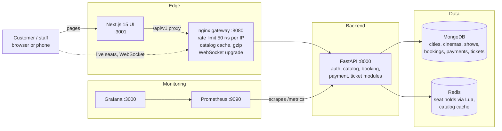
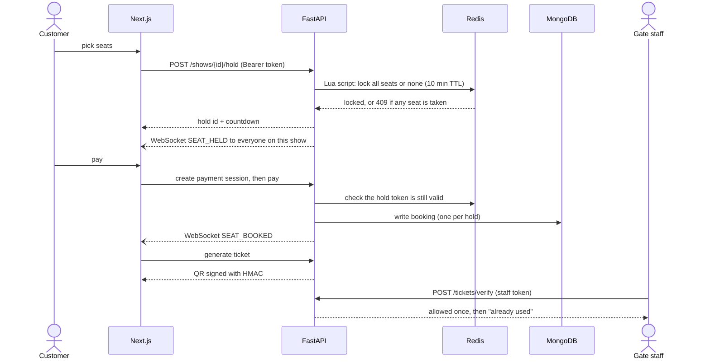
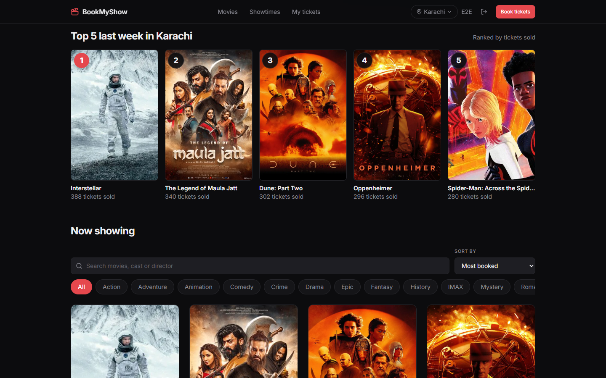
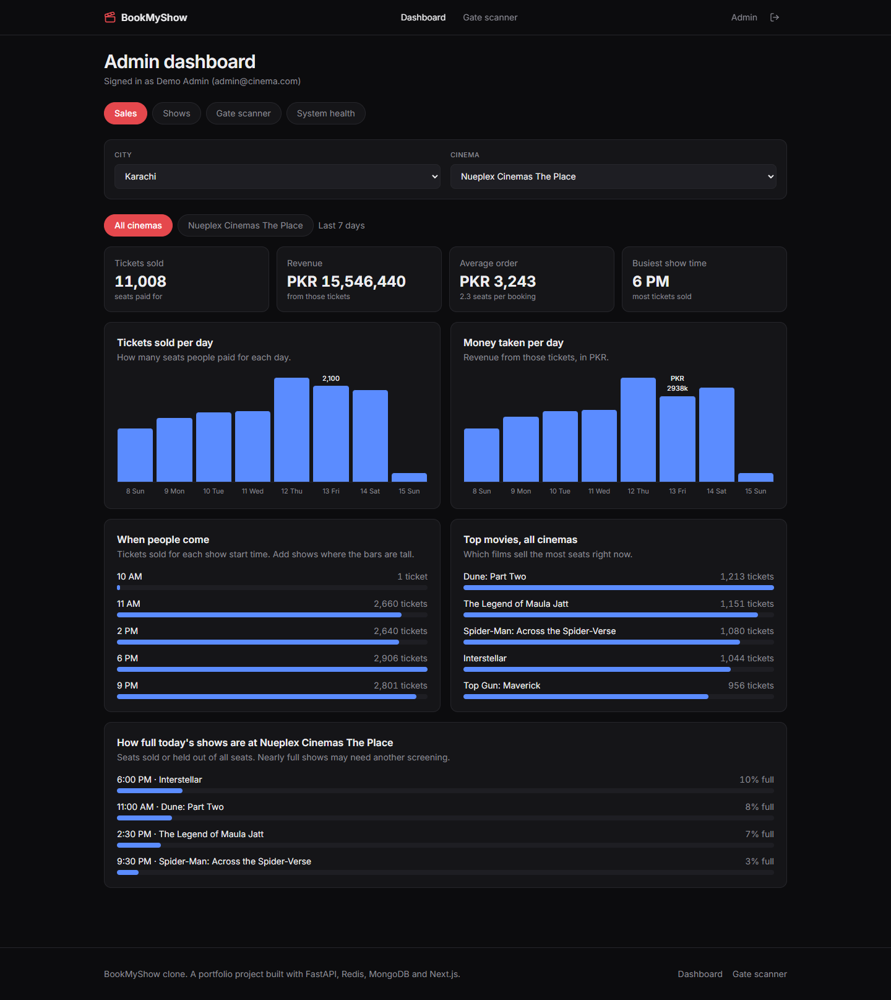
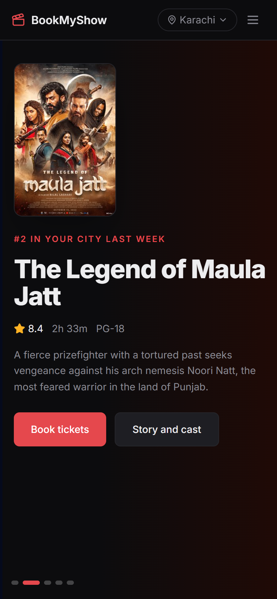
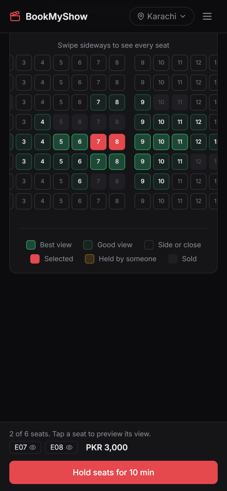
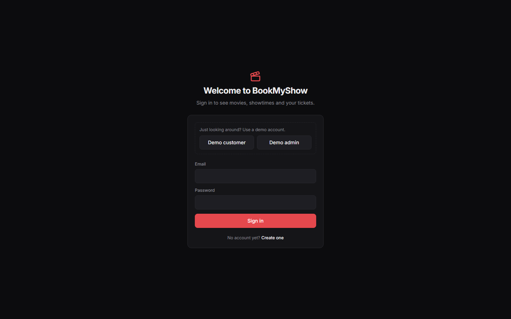

# BookMyShow Clone

A movie ticket booking system built to survive the rush: **many people clicking the same seat at the same moment, and nobody gets double-booked.**

Full stack: Next.js UI, FastAPI backend, atomic seat locks in Redis, live seat updates over WebSockets, signed QR tickets, and a staff gate scanner. It runs with one command and has a live Grafana dashboard.


---

## Results at a glance

| What | Result |
| :--- | :--- |
| Double bookings | **0**. 50 requests hit the same seat at the same millisecond: exactly 1 wins, 49 get `409 Conflict` |
| Load test (1,000 users) | **97 ms** median, **423 req/s**, **99.994%** success (3 failures in 49,013 requests) |
| Speed-up from tuning | **14x** lower median latency than the baseline |
| Automated tests | **28** backend tests (concurrency, payments, tickets, auth) plus frontend checks, all passing |
| End-to-end booking | Sign up, hold, pay, ticket, first gate scan allowed, second scan denied: passing |
| Startup | `docker compose up`: UI, API, nginx, MongoDB, Redis, Prometheus, Grafana and sample data |

---

## Architecture



**How a seat stays safe**



---

## Features

**Customers**
- Sign in first, then see only your city's cinemas, showtimes and weekly Top 5
- Showtimes by day: 7-day strip, calendar, filters for time, price and seats left
- Seat map with a **best-view heatmap**, "pick the best seats for me", tier prices and seats left
- Seat preview: see the screen from your seat before paying
- Live seat updates: seats others hold or buy change color instantly
- Ticket wallet on the device, QR full screen, save as image

**Staff (admin)**
- Sales dashboard: tickets and money per day, busiest show times, top movies, how full today's shows are
- Add, edit and remove shows
- Gate scanner: camera or paste. Reused and forged tickets are rejected

**Safety**
- Seat holds are atomic (all seats or none) and expire after 10 minutes
- The user always comes from the sign-in token, never from the request body
- QR tickets are HMAC-signed: changing one seat breaks the signature
- Each ticket gets in once

---

## Screenshots

| | |
| :---: | :---: |
|  **Top 5 in your city, movie catalog** |  **Showtimes by day** |
|  **Seat map with best-view heatmap** |  **Seats held, 10-minute countdown** |
|  **Signed QR ticket** |  **Gate scan: second use denied** |
|  **Admin sales dashboard** |  **Grafana: seat holds, wins vs conflicts** |

**On a phone**

| | | |
| :---: | :---: | :---: |
|  |  |  |

---

## Load and concurrency tests

**Load tests (Locust, through nginx)**

| Run | Setup | Requests | Median | Throughput | Result |
| :--- | :--- | ---: | ---: | ---: | :--- |
| 1. Baseline | 500 users, 1 worker, no cache | 16,589 | 2,400 ms | 145 req/s | 33% failed (test hit a city that wasn't seeded) |
| 2. Tuned | 1,000 users, 4 workers, Redis cache, indexes | 49,013 | **97 ms** | **423 req/s** | **99.994% success** |
| 3. Rate limit | 2,000 users from one IP | 57,071 | n/a | n/a | nginx blocked 90% with `503` by design, API stayed up with 0 crashes |

**What changed between run 1 and run 2:** Redis cache for cities, cinemas and shows (5 min, cleared on change), compound MongoDB indexes, connection pool of 200, `orjson`, and 4 Uvicorn workers.

**Concurrency tests (real Redis, `asyncio.Barrier`)**

| Test | Result |
| :--- | :--- |
| 50 users, same seat, same instant | 1 hold, 49 conflicts |
| 10 overlapping multi-seat requests | 0 partial holds |
| Same hold released twice at once | 1 success, 1 rejected |
| Same hold confirmed twice at once | exactly 1 booking |
| Same idempotency key twice | same hold returned |
| Hold expires (TTL) | seat becomes free again |
| Confirm after expiry | `410 Gone`, no booking |

Full history and reasoning: [DECISIONS_AND_BENCHMARKS.md](DECISIONS_AND_BENCHMARKS.md).

---

## Run it

**Requires:** Docker Desktop.

```bash
docker compose up -d --build
```

| Open | URL |
| :--- | :--- |
| App | http://localhost:3001 |
| API docs (Swagger) | http://localhost:8000/docs |
| Grafana (admin / admin) | http://localhost:3000 |
| Prometheus | http://localhost:9090 |

- **Sample data** loads on the first start: 5 cities, 18 cinemas, about 1,100 shows and 5,200 bookings. It is skipped when the database already has data.
- **Staff login (development only):** `admin@cinema.com` / `demo-admin-123`. Customers sign up in the app.
- **Port 3001 taken?** Run with `WEB_PORT=3005 docker compose up -d`.

**Local development** (API and UI on your machine, infra in Docker):

```bash
# PowerShell: $env:BACKEND_HOST="host.docker.internal:8000"
BACKEND_HOST=host.docker.internal:8000 docker compose up -d mongodb redis nginx prometheus grafana
uv sync && uv run uvicorn src.main:app --port 8000      # API
cd frontend && npm install && npm run dev                # UI on :3001
```

**Tests**

```bash
uv run pytest -q                 # 28 backend tests (needs MongoDB and Redis running)
cd frontend && npm test          # seat scoring checks
```

**Camera scanning on a phone:** browsers only allow the camera on HTTPS. For a quick local test on Android Chrome, open `chrome://flags/#unsafely-treat-insecure-origin-as-secure`, add `http://<your-PC-IP>:3001`, and restart Chrome. Pasting the QR text works everywhere.

---

## Tech stack

| Layer | Choice | Why |
| :--- | :--- | :--- |
| UI | Next.js 15, React 19, Tailwind | App Router, fast builds, one design token set |
| API | FastAPI, Python 3.14, uv | Async, typed requests with Pydantic v2 |
| Database | MongoDB + Beanie | Seat layouts and shows fit documents well |
| Locks and cache | Redis 7, Lua scripts | One atomic step to lock many seats, built-in expiry |
| Gateway | nginx | Rate limiting, caching, WebSocket proxy |
| Monitoring | Prometheus + Grafana | Custom metrics: seat hold wins vs conflicts, latency |
| Load testing | Locust | Realistic users with think time |
| CI | GitHub Actions | Lint, 28 tests with real Mongo and Redis, typecheck, build, guardrails |

---

## Project structure

```
src/
  features/      cities, cinemas, shows (catalog, Redis cached)
  modules/       auth, booking (Redis Lua locks, WebSockets), payment, ticket (HMAC QR)
  bootstrap/     app setup, config, database, Redis, metrics
frontend/src/
  app/           pages: home, seats, tickets, admin, scanner
  components/    ui kit, booking, admin, home sections
  hooks/ lib/    data hooks, API client, seat scoring
tests/           pytest suites, Locust load test
docker/          nginx, Prometheus, Grafana config, API Dockerfile
scripts/         seed data, traffic generator for Grafana
.github/         CI workflow
.guardrails/     pre-commit and pre-push safety hooks
```

---

## Known limits

- **One API instance for live seats:** WebSocket updates are sent from memory, so several API instances would need Redis pub/sub first. Seat locking itself is already safe across instances.
- **Payments are simulated:** a mock gateway with a Stripe-style webhook path. No real money moves.
- **The seat heatmap is a rule of thumb** (best seats about 60% back, near the center), not real data from each cinema.
- **Kafka and Elasticsearch** are in `docker-compose.yml` as optional profiles but not used by the code yet.

---

## Contributing

- AI assistants: read [AGENTS.md](AGENTS.md) and [GUARDRAILS.md](GUARDRAILS.md) first.
- Use feature branches (`feature/...`, `bugfix/...`). Pushing straight to `main` is blocked by a hook.
- Every pull request runs CI.

## License

MIT.
