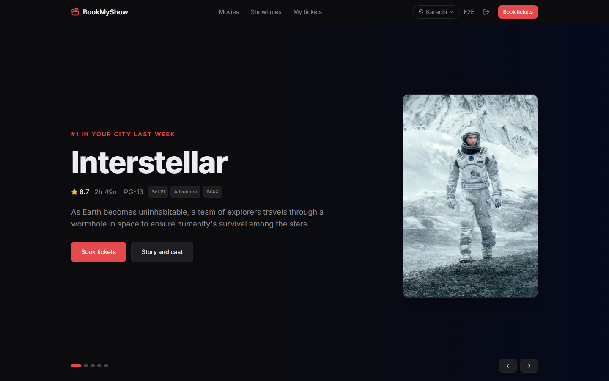
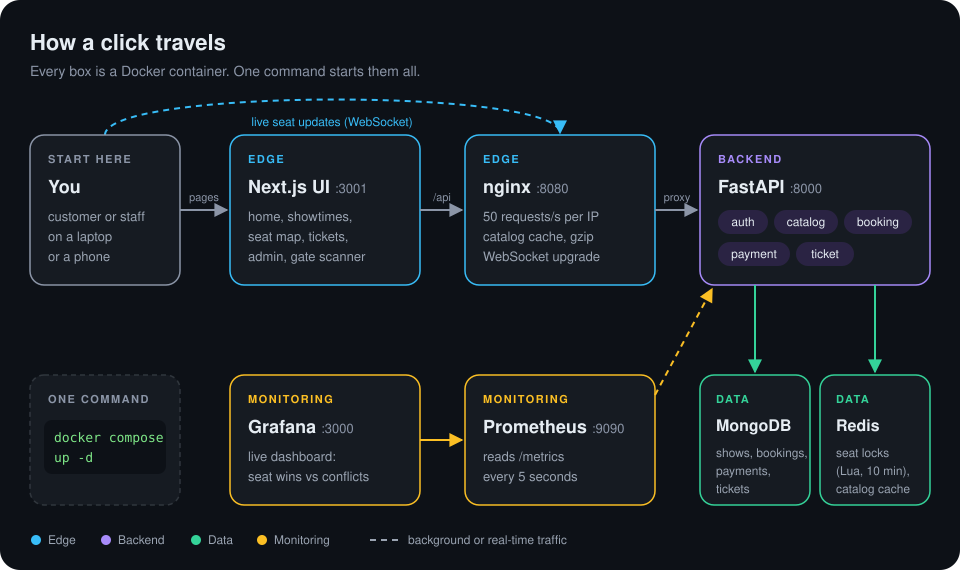
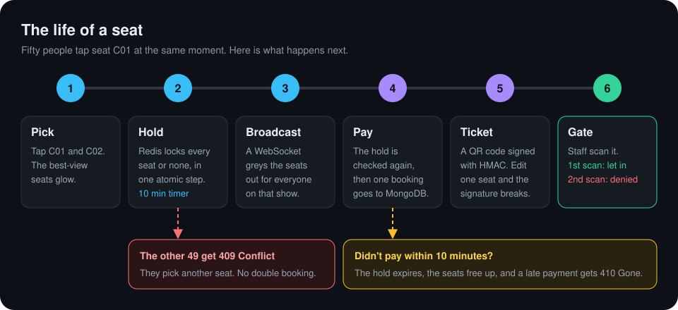
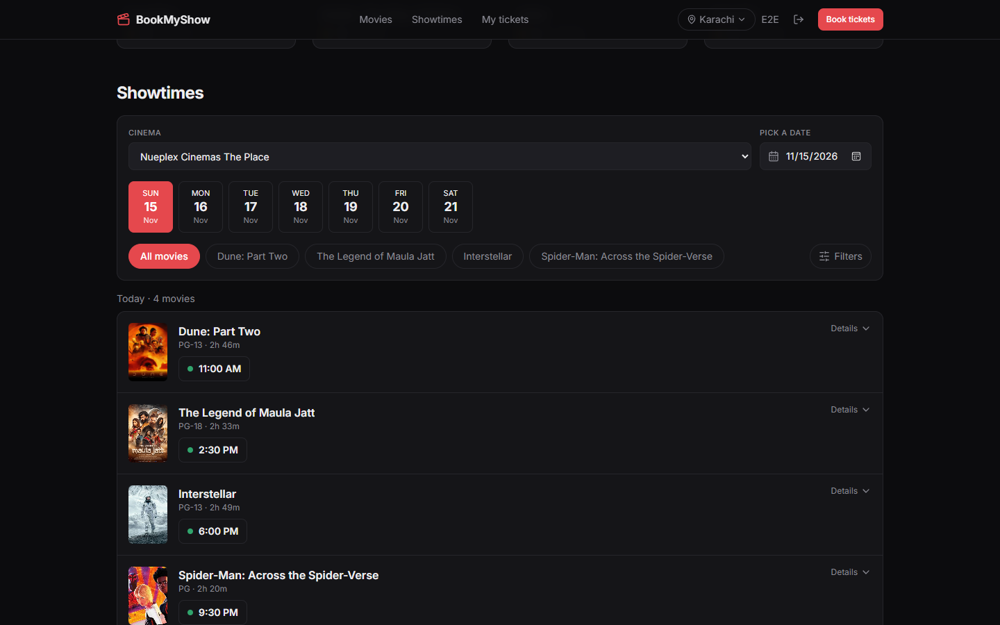
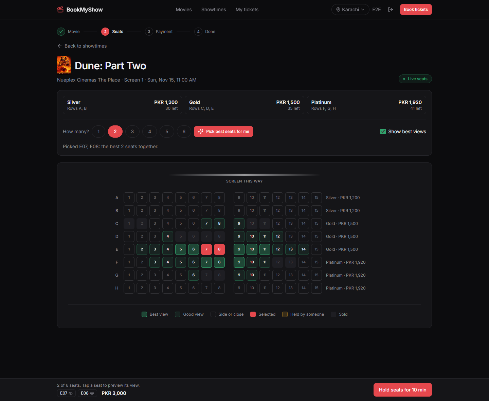
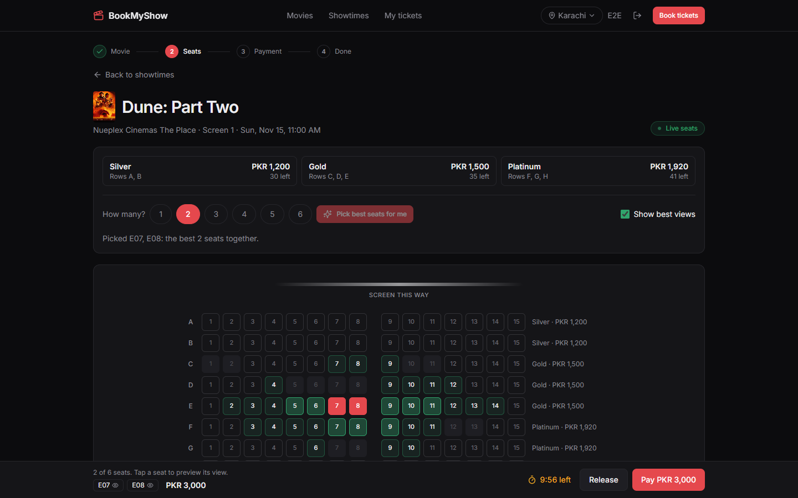
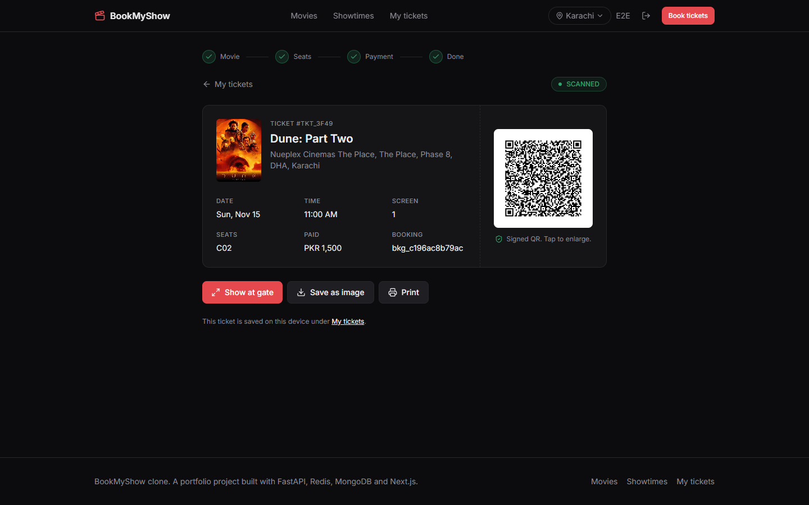
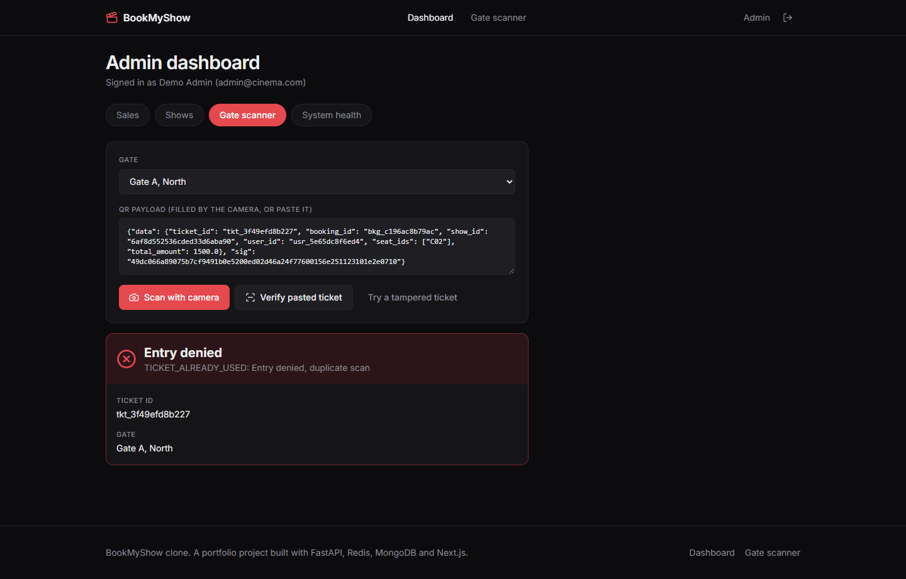
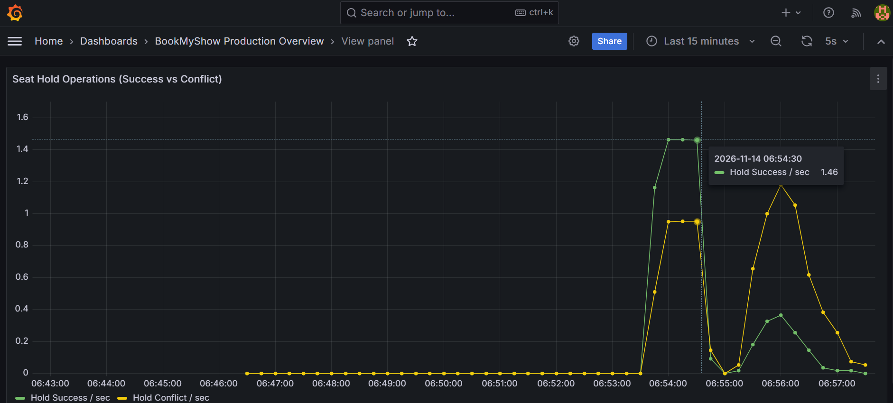

<div align="center">

# 🎬 BookMyShow Clone

### 50 people tap the same seat at the same millisecond. Exactly one gets it.

A full-stack movie ticket booking system built for the opening-night rush:
atomic seat locks, live seat maps, signed QR tickets and a staff gate scanner.


[**Run it in 2 minutes**](#-run-it-in-2-minutes) · [How it works](#-how-it-works) · [Screenshots](#-screenshots) · [Load tests](#-load-and-concurrency-tests)



</div>

---

## 🏆 Results at a glance

| | Result |
| :--- | :--- |
| 🎯 **Double bookings** | **0**. 50 requests hit one seat at once: 1 wins, 49 get `409 Conflict` |
| ⚡ **1,000 users** | **97 ms** median, **423 req/s**, **99.994%** success |
| 🚀 **Tuning** | **14x** faster median than the first version |
| ✅ **Tests** | **28** backend tests (concurrency, payments, tickets, auth), all passing |
| 🎟️ **End to end** | Sign up, hold, pay, ticket, scan in, second scan denied: passing |
| 🐳 **Startup** | One command runs 8 containers with sample data |

---

## 🚀 Run it in 2 minutes

The app is published as ready-made images on Docker Hub, so nothing has to be built.

| Image | Docker Hub |
| :--- | :--- |
| 🐍 API (FastAPI) | [`noumandockeruser65/bookmyshow-api`](https://hub.docker.com/r/noumandockeruser65/bookmyshow-api) |
| ⚛️ Web (Next.js) | [`noumandockeruser65/bookmyshow-web`](https://hub.docker.com/r/noumandockeruser65/bookmyshow-web) |

**You need:** [Docker Desktop](https://www.docker.com/products/docker-desktop/) running. That's it.

**1. Get the project** (it holds the config for nginx, Prometheus and Grafana)

```bash
git clone https://github.com/NoumanZahid-85/BookMyShow.git
cd BookMyShow
```

**2. Pull the images**

```bash
docker compose pull
```

**3. Start everything**

```bash
docker compose up -d
```

**4. Open the app** at **http://localhost:3001** 🎉

The first start loads sample data (5 cities, 18 cinemas, about 1,100 shows and 5,200 bookings). Give it about 30 seconds.

| Open | Where | Login |
| :--- | :--- | :--- |
| 🎬 App | http://localhost:3001 | Sign up as a customer |
| 🛠️ Staff view | http://localhost:3001/admin | `admin@cinema.com` / `demo-admin-123` |
| 📘 API docs | http://localhost:8000/docs | |
| 📊 Grafana | http://localhost:3000 | `admin` / `admin` |
| 🔥 Prometheus | http://localhost:9090 | |

> [!TIP]
> **Want a specific version?** Pull it by tag:
> `docker pull noumandockeruser65/bookmyshow-api:<tag>` and `docker pull noumandockeruser65/bookmyshow-web:<tag>`,
> then start with `API_IMAGE=noumandockeruser65/bookmyshow-api:<tag> WEB_IMAGE=noumandockeruser65/bookmyshow-web:<tag> docker compose up -d`.
> Without a tag you get `latest`.

<details>
<summary><b>🔧 Something not working?</b></summary>

| Problem | Fix |
| :--- | :--- |
| Port 3001 is taken | `WEB_PORT=3005 docker compose up -d`, then open http://localhost:3005 |
| PowerShell says `WEB_PORT=...` is not a command | Run `$env:WEB_PORT="3005"` first, then `docker compose up -d` |
| The page loads but shows no movies | Sample data is still loading. Wait 30 seconds and refresh |
| Want to start fresh | `docker compose down -v` (this deletes the sample database) |
| Stop everything | `docker compose down` |

</details>

<details>
<summary><b>🛠️ Build the images from source instead</b></summary>

```bash
docker compose up -d --build
```

This builds the API and web images on your machine from the code in this repo.

</details>

---

## 🧭 How it works

<div align="center">



</div>

**Follow one click, left to right:**

1. **You** open the app. The **Next.js UI** draws the pages.
2. Every API call goes through **nginx**, which limits each IP to 50 requests a second and caches the movie catalog.
3. **FastAPI** does the work. It is split into small modules: auth, catalog, booking, payment and ticket.
4. **Redis** holds seat locks for 10 minutes. **MongoDB** stores shows, bookings, payments and tickets.
5. Seat changes come back to every open browser over a **WebSocket**, so seat maps update live.
6. **Prometheus** reads the API's numbers every 5 seconds and **Grafana** turns them into a live dashboard.

### 💺 The life of a seat

<div align="center">



</div>

The key trick is step 2. A small **Lua script** runs inside Redis and locks all the seats you picked in **one atomic step**. Redis runs one script at a time, so two people can never both win the same seat, even if they click at the same millisecond.

---

## ✨ Features

<table>
<tr>
<td width="33%" valign="top">

**🍿 Customers**
- Your city's cinemas, showtimes and weekly Top 5
- 7-day showtime strip, calendar and filters
- Seat map with a **best-view heatmap**
- "Pick the best seats for me"
- See the screen from your seat before paying
- Live seat colors as others book
- Ticket wallet, full-screen QR, save as image

</td>
<td width="33%" valign="top">

**🛠️ Staff**
- Sales dashboard: tickets and money per day
- Busiest show times and top movies
- How full today's shows are
- Add, edit and remove shows
- Gate scanner: camera or paste
- Reused and forged tickets rejected

</td>
<td width="33%" valign="top">

**🔒 Safety**
- Seat holds: all seats or none
- Holds expire after 10 minutes
- The user always comes from the sign-in token, never the request body
- HMAC-signed QR tickets
- Each ticket gets in once
- Rate limiting at the gateway

</td>
</tr>
</table>

---

## 📸 Screenshots

| | |
| :---: | :---: |
|  **Top 5 in your city** |  **Showtimes by day** |
|  **Seat map with best-view heatmap** |  **Seats held, 10-minute countdown** |
|  **Signed QR ticket** |  **Gate scan: second use denied** |
|  **Staff sales dashboard** |  **Grafana: seat wins vs conflicts** |

**📱 On a phone**

| | | |
| :---: | :---: | :---: |
|  |  |  |

---

## 📈 Load and concurrency tests

**Load tests** (Locust, through nginx)

| Run | Setup | Requests | Median | Throughput | Result |
| :--- | :--- | ---: | ---: | ---: | :--- |
| 1. Baseline | 500 users, 1 worker, no cache | 16,589 | 2,400 ms | 145 req/s | 33% failed (test hit a city that wasn't seeded) |
| 2. Tuned | 1,000 users, 4 workers, Redis cache, indexes | 49,013 | **97 ms** | **423 req/s** | ✅ **99.994% success** |
| 3. Rate limit | 2,000 users from one IP | 57,071 | n/a | n/a | 🛡️ nginx blocked 90% by design, 0 API crashes |

**From 2,400 ms to 97 ms:** Redis cache for cities, cinemas and shows (5 min, cleared on change), compound MongoDB indexes, a connection pool of 200, `orjson`, and 4 Uvicorn workers.

**Concurrency tests** (real Redis, everyone released at once with `asyncio.Barrier`)

| Test | Result |
| :--- | :--- |
| 50 users, same seat, same instant | ✅ 1 hold, 49 conflicts |
| 10 overlapping multi-seat requests | ✅ 0 partial holds |
| Same hold released twice at once | ✅ 1 success, 1 rejected |
| Same hold confirmed twice at once | ✅ exactly 1 booking |
| Same idempotency key twice | ✅ same hold returned |
| Hold expires | ✅ seat is free again |
| Pay after the hold expired | ✅ `410 Gone`, no booking |

---

## 👩‍💻 Develop locally

<details>
<summary><b>Run the API and UI on your machine, with the rest in Docker</b></summary>

```bash
# PowerShell: $env:BACKEND_HOST="host.docker.internal:8000"
BACKEND_HOST=host.docker.internal:8000 docker compose up -d mongodb redis nginx prometheus grafana
uv sync && uv run uvicorn src.main:app --port 8000      # API
cd frontend && npm install && npm run dev                # UI on :3001
```

**Tests**

```bash
uv run pytest -q                 # 28 backend tests (needs MongoDB and Redis running)
cd frontend && npm test          # seat scoring checks
```

**Camera scanning on a phone:** browsers only allow the camera on HTTPS. For a quick local test on Android Chrome, open `chrome://flags/#unsafely-treat-insecure-origin-as-secure`, add `http://<your-PC-IP>:3001`, and restart Chrome. Pasting the QR text works everywhere.

</details>

---

## 🧰 Tech stack

| Layer | Choice | Why |
| :--- | :--- | :--- |
| UI | Next.js 15, React 19, Tailwind | App Router, fast builds, one design token set |
| API | FastAPI, Python 3.14, uv | Async, typed requests with Pydantic v2 |
| Database | MongoDB + Beanie | Seat layouts and shows fit documents well |
| Locks and cache | Redis 7, Lua scripts | One atomic step to lock many seats, built-in expiry |
| Gateway | nginx | Rate limiting, caching, WebSocket proxy |
| Monitoring | Prometheus + Grafana | Custom metrics: seat hold wins vs conflicts, latency |
| Load testing | Locust | Realistic users with think time |

---

## 🗂️ Project structure

```
src/
  features/      cities, cinemas, shows (catalog, Redis cached)
  modules/       auth, booking (Redis Lua locks, WebSockets), payment, ticket (HMAC QR)
  bootstrap/     app setup, config, database, Redis, metrics
frontend/src/
  app/           pages: home, seats, tickets, admin, scanner
  components/    UI kit, booking, admin, home sections
  hooks/ lib/    data hooks, API client, seat scoring
tests/           pytest suites, Locust load test
docker/          nginx, Prometheus, Grafana config, API Dockerfile
scripts/         sample data, traffic generator for Grafana
```

---

## 🚧 Known limits

- **Live seats need one API instance.** WebSocket updates are sent from memory, so more instances would need Redis pub/sub first. Seat locking is already safe across instances.
- **Payments are simulated.** A mock gateway with a Stripe-style webhook. No real money moves.
- **The seat heatmap is a rule of thumb** (best seats about 60% back, near the center), not real data from each cinema.
- **Kafka and Elasticsearch** are optional profiles in `docker-compose.yml` and are not used by the code yet.
- **The demo staff login** only exists when `APP_ENV=development`. Never run that mode on a public server.

---

<div align="center">

**Built by [Nouman Zahid](https://github.com/NoumanZahid-85)** · If this helped you, a ⭐ helps others find it.

</div>
